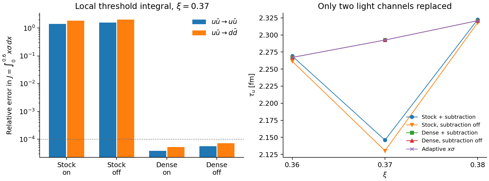
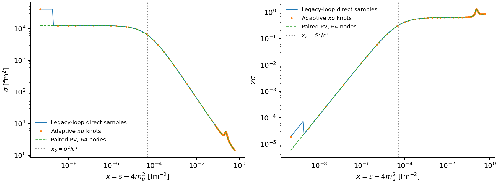

# 阈值缓存与 B₀ 端点算法对照（2026-10-21）

本轮完成了节点加密 × 扣除开关的消融、自适应 `σ` / `xσ` 候选、独立 B₀ 端点核验，以及同误差目标的性能比较。结论是：**ξ≈0.37 的凹陷主要由阈值缓存分辨率不足造成；端点求值另有独立误差。`xσ` 自适应方法值得保留，但本例未显示可靠的总耗时优势，目前不全局替换生产默认。**

本页记录 2026-10-21 冻结批次：当时的实现位于 `scripts/analysis/relaxtime/` 和 `benchmark/relaxtime/`，该批次没有改动输运生产源码、默认积分参数或生产数据，也没有启动 Actions。后续角度合并的源码升级、统一采样资格及重跑前收敛结果见[当前验证说明](production_sampling_20261022.md)，不追溯改变本页冻结证据。

[采样、有限能量共振与原策略成本补充](followup_20261022.md) 给出原网格的实际缺口、
Mott 阈值积分连续性的条件、x≈0.23 小峰的混合标量贡献分解，以及原生产策略的同点计时。

[热平均优化与原始异常验证](optimization_20261022.md) 记录后续实际调用路径优化与 mode A 多窗口核验；其源码变动不追溯改变本页各批次的冻结证据。

## 范围、输入和量纲

- 工作树：`D:\w\meson-freezeout-defaults`，分支 `codex/meson-freezeout-defaults`，基准 HEAD `698feaf8fada670fde81c93bab6093b50093935f`。该工作树已有其他冻结线改动，本轮保留它们；实际运行源码以各批次的 `source/` 快照为准。
- 输入：历史 `review_followup_20261013` 的 `review_points.csv`、`channel_plan.csv`。本轮逐批复制原始输入并保存 SHA-256，不重新解 gap；有效耦合使用原各向同性 A，极化沿用原 full-RS A，而 B₀ 的分布修正仍为原一阶 ξ 约定。
- 主消融：μB=0、αT=1，ξ=0.36、0.37、0.38，过程 `uubar_to_uubar`、`uubar_to_ddbar`。另以 ξ=−0.25、−0.20、0 的 `uubar_to_uubar` 检查自适应算法。
- 热平均固定 `p128 / angle20 / phi36`，截面 t 积分为 24 点；动量映射、截面支持区间及 cutoff 沿用原调用。本轮误差目标约束缓存误差，不代表整个输运问题的总误差已经收敛。
- 定义 `s0=4m_u²`、`x=s−s0`，局部窗口 `0≤x≤0.6 fm⁻²`。σ 的量纲为 fm²，`J=∫xσ dx` 的量纲为 fm⁻²。
- CSV 中 `rate` 是平均截面乘相对速度 `⟨σv⟩`，量纲 **fm²**。乘数密度后的 `source_contribution` 和总逆弛豫时间才是 **fm⁻¹**；τ 为 fm。

证据根目录：[threshold_cache_upgrade_20261021](../../../../data/outputs/results/relaxtime/transport/threshold_cache_upgrade_20261021/)。

| 批次 | 内容 |
| --- | --- |
| `ablation_v1` | 六个背景/通道组合、24 组四格消融，直接积分基准与部分 τ 重建 |
| `endpoint_v1` | 108 组 B₀ 阈值探针，独立 QuadGK oracle |
| `candidates_v1` | 第一版误差探针，42 组 J 对照、21 个完整热平均 |
| `candidates_v2` | 复用四分点/中点的版本，42 组 J 对照；24 个紧精度表与 v1 逐字节相同 |
| `performance_v1` | 首轮顺序计时，保留明显的耗时波动 |
| `performance_v2` | 交错顺序、CPU 时间及墙钟时间的同精度基准 |
| `analysis_v2` | 当前汇总、哈希核验、派生表和诊断图；`analysis_v1` 保留初版绘图 |

每个数值批次都已完成，输入和归档源码通过 [audit.json](../../../../data/outputs/results/relaxtime/transport/threshold_cache_upgrade_20261021/analysis_v2/audit.json) 核验。历史快照按各自 manifest 检查，不拿当前源码覆盖旧证据。

## 1. 分开检验节点与扣除项

四格分别为原网格/密集网格和扣除开/关。每个背景/通道的拟合系数 A 固定为原缓存值，**密集网格不重新拟合 A**。新增网格保留所有原点，再嵌套添加 N=96、192 的 log-x 与均匀 √x 节点。这里改变的是截面函数的 s 取点；提高热平均 p 节点或 t 积分节点不等同于解析这个阈值尺度。

ξ=0.37 的局部 J 相对直接积分的偏差：

| 通道 | 原网格，扣除开 | 原网格，扣除关 | 密集网格，扣除开 | 密集网格，扣除关 |
| --- | ---: | ---: | ---: | ---: |
| uū→uū | +140.6908% | +158.7520% | +0.003840% | +0.005549% |
| uū→dd̄ | +185.1978% | +204.5157% | +0.005285% | +0.007113% |

关掉扣除项使原网格的偏差更大；充分解析阈值后，两种开关状态都接近直接积分。因而本例不能归因为“使用 A/√x 扣除就会产生凹陷”。主要问题是原取点不能分辨狭窄结构；扣除项会影响误差，但不是这次消融中的主因。

直接 J 在 `q=√x` 下求积；128→256 点的最大相对变化为 `3.20e−12`，t24→t48 为 `6.26e−11`。缓存 J 按每个插值区间分段求积，12→24 点的最大变化为 `1.17e−4`，出现在含裁剪折点的原缓存。这里更新了局部积分的数值读数；此前单段求积得到的约 +141.01% 与本轮 +140.69% 不表示背景发生变化。

将两个通道的新平均截面按原密度贡献替回总逆 τ，其他通道保留历史值：

| ξ | 原 τu [fm] | 密集网格、扣除开 [fm] |
| --- | ---: | ---: |
| 0.36 | 2.269062 | 2.267100 |
| 0.37 | 2.145957 | 2.292556 |
| 0.38 | 2.322656 | 2.320931 |

中心点相对两侧点均值的偏离从 −6.53% 减至约 −0.064%。这是重新计算截面缓存后的两通道贡献替换，未对 τ 曲线做平滑。该对照支持此处存在显著数值凹陷；它不能证明所有其他突变都有同一来源，也不是所有通道的生产重算。



## 2. 阈值尺度、自适应误差和 xσ

若阈值附近的有效传播子分母可以局部写作

\[
H(s_0+x)=\delta+b x-i c\sqrt{x}+O(x^{3/2}),
\]

且相应截面分子在阈值非零、光滑，则相关贡献具有

\[
\sigma(x)\simeq\frac{C(x)}{(\delta+b x)^2+c^2x},
\qquad x_\delta=\frac{\delta^2}{c^2}.
\]

在有限失谐 δ≠0 时，σ 在 x→0 仍有限，但其变化可集中在极小的 `xδ`。当 δ→0 且 C(0)≠0 时，σ 的主导行为为 1/x，`xσ` 则趋于有限值。这个推导说明本例选择 `xσ` 的理由；并非所有通道的分子、干涉项或阈值幂次都相同。

本背景中混合赝标量行列式的 `xδ` 从 ξ=0.36 的 `1.399e−3`，缩到 ξ=0.37 的 `5.085e−5`，再到 ξ=0.38 的 `2.519e−3 fm⁻²`。因此，即便 ξ 等步长，所需的 s 分辨率也会明显改变。此处把行列式用于取点尺度估计，不据此认定某个物理本征态的 Mott 点或有限输运跳变。

已实现的算法：

1. 使用原局部节点、12 个 log-x 种子，以及 π/混合分母估计的 `0.1、0.3、1、3、10 × xδ`，限制在 `[s0×10⁻¹⁰, 0.6]` 内。
2. 在每个区间的 1/4、1/2、3/4 处直算 σ，估计
   \[
   E_i=\int_{x_i}^{x_{i+1}}x\,|\sigma_{\rm direct}(x)-\sigma_{\rm interp}(x)|\,dx.
   \]
   使用复合 Simpson 权重并优先二分最大误差区间。父区间的四分点成为子区间的中点，已算结果可复用。
3. 停止条件为 `ΣEi ≤ atol + rtol |J|`，本轮 `atol=10⁻¹⁰`、`rtol=10⁻³/10⁻⁴`。达到节点预算仍未达标时返回 `converged=false`，消费者拒绝使用。
4. 局部区间用自适应表，区间外保留原缓存，低于首个正 x 节点时保留直算。完整热平均使用与生产同一公式的 callable 消费器，已做同点一致性检查。

这里的权重为 x，并非所有各向异性背景下精确的热权重；误差估计也不是对任意漏采尖峰的严格数学上界。因此另以独立直接 J 和完整热平均核验。

ξ=0.37、rtol=10⁻⁴ 的局部表比较：

| 通道 / 表示 | 插值节点 | v1 新 σ 求值 | v2 新 σ 求值 |
| --- | ---: | ---: | ---: |
| uū→uū，σ | 268 | 1527 | 1055 |
| uū→uū，xσ | 124 | 663 | 479 |
| uū→dd̄，σ | 302 | 1731 | 1191 |
| uū→dd̄，xσ | 143 | 777 | 555 |

两个版本的 24 个紧精度表逐字节相同，因此复用 v1 的热平均结果。v2 的 `consumer_parity=false` 与 `rates=0` 表示 `tables-only` 批次未重复热平均，不是检查失败。42 组独立 J 均满足各自误差目标，紧精度最大相对偏差为 `8.40e−5`。

**xσ 不在所有背景下更省节点。** ξ=−0.25 时 σ / xσ 分别为 165 / 175 个节点；ξ=0 时为 189 / 187。合理的升级方向是按背景或区间选择表示，避免全局强制 xσ。

## 3. 独立处理 B₀ / 主值端点

令等质量、k=0 情形下

\[
F(p)=\frac{1-f_q(p)-f_{\bar q}(p)}{E_p},\quad
q^2=\frac{s-4m^2}{4}.
\]

F 保留原程序的一阶 ξ 分布修正。沿用原正能量 cut 符号及三动量截断 Λ：

\[
\operatorname{Re}B_0=2\operatorname{PV}\int_0^\Lambda
\frac{p^2F(p)}{p^2-q^2}\,dp.
\]

阈值上方且 `0<q<Λ`，解析扣除给出

\[
B_0=2\int_0^\Lambda F(p)dp
+2q^2\int_0^\Lambda\frac{F(p)-F(q)}{p^2-q^2}dp
+qF(q)\log\left|\frac{\Lambda-q}{\Lambda+q}\right|
+i\pi qF(q).
\]

阈值下方写作 `q=iκ`：

\[
B_0=2\int_0^\Lambda F(p)dp
-2\kappa^2\int_0^\Lambda\frac{F(p)-F(0)}{p^2+\kappa^2}dp
-2\kappa F(0)\arctan(\Lambda/\kappa).
\]

于是阈值值为 `2∫F dp`，并显式保留

\[
B_0(s_0-x)=B_0(s_0)-\frac{\pi F(0)}2\sqrt{x}+O(x),\qquad
B_0(s_0+x)=B_0(s_0)+i\frac{\pi F(0)}2\sqrt{x}+O(x).
\]

这里的扣除来自积分恒等式；不拟合 A，不插值 B₀，也不挖去极点邻域。可去奇点使用差商极限，固定背景下预计算积分节点与 F 并复用。由这些式子到极化、传播子再到 σ 的非解析结构得到保留。

独立 oracle 在阈值上使用另一种 p-Cauchy 分子扣除，在阈值下直接分段解析窄层；QuadGK 只通过 `benchmark/` 独立环境调用。探针为 ξ=−0.25、−0.20、0、0.36、0.37、0.38，u/s 两种质量，以及 `s=4m²(1+ε)`、`ε=0, ±10⁻³, ±10⁻⁶, ±10⁻⁹, ±10⁻¹²`。

| 候选节点数 | 108 组中最大 B₀ 绝对误差 |
| --- | ---: |
| 32 | 1.57e−8 |
| 64 | 9.33e−11 |
| 128 | 2.05e−12 |

预设要求为绝对误差 `<10⁻⁸`，64 节点全部通过；oracle 最大误差估计为 `2.70e−11`，故不能把接近机器精度的单点吻合外推为无限精度。旧方法在这组刻意逼近端点的探针中有 34 个异常/非有限结果，其余有限结果最大偏差为 `2.76e−3`。这些计数不表示生产网格有 34 个失败点。

截面层也能直接看到输入误差：ξ=0.37、uū→uū，在 `x=4.63995e−10 fm⁻²`，旧环函数的直算 σ 约为 `41307.4 fm²`，新 PV 候选约为 `12538.1 fm²`。下图保留这处极小 x 的差别；“直算”本身不能作为输入正确的保证。



但这个极窄区域的热权重很小。在六个主消融背景/通道上，只将 `x≤0.6` 内的 s 道极化替成该 PV 候选，热平均最大相对变化为 `6.06e−8`，远小于稀疏缓存造成的变化。因此本例的凹陷修复主要来自取点；端点升级独立提高了输入的可靠性。这个局部替换实验不约束其他背景或极点位置的敏感性。

**适用范围：等质量、k=0、实轴、原线性 ξ 约定。** 当前不覆盖不等质量 K 环、有限 k 或复能量延拓；临时覆盖并恢复四个极化缓存键的接口只用于单线程对照，不能原样作为生产并行后端。

## 4. 同误差目标的稳定性与性能

代表点为 ξ=0.37、uū→uū，三种策略均使用旧 B₀ 和同一背景，区间外使用原始 σ 缓存，以隔离缓存算法的成本。比较目标同时要求局部 J 和固定 p128 热平均的相对误差 `≤10⁻⁴`。热平均参考为 dense768；dense384→768 的相对变化为 `6.05e−7`。

每种策略先预热，再计时三次；每次构建前清空极化缓存。固定背景求解不计入时间。v2 以三种循环顺序交错运行，记录 Windows `GetProcessTimes` 的用户+内核 CPU 时间，同时保留墙钟时间；复用了源码和输入哈希一致的 v1 参考积分。

| 策略 | 全表节点¹ | 新 σ 求值² | J 相对误差 | 热平均相对误差 | 总墙钟中位数 [s] | 总 CPU 中位数 [s] |
| --- | ---: | ---: | ---: | ---: | ---: | ---: |
| 固定 dense192 | 998 | 476 | +5.55e−5 | +3.35e−6 | 24.06 | 22.39 |
| 自适应 σ | 777 | 1056 | +8.35e−5 | +9.83e−6 | 29.88 | 27.47 |
| 自适应 xσ | 633 | 480 | +2.89e−5 | −5.45e−6 | 24.88 | 23.09 |

¹ 含局部表与保留的外部节点，不同于上一节的局部节点数。² 不计三种方法共有的原缓存构建，但计入额外边界求值，因此与候选表试验相差一次。总时间为每次构建加一次完整热平均。

v2 的总墙钟范围分别为 24.02–31.14、28.00–34.71、23.95–33.22 秒；总 CPU 范围分别为 22.31–24.36、25.86–30.00、22.31–27.17 秒。三次测量的数值结果各自相同。首轮 v1 的墙钟波动更大，已完整保留，不能选择其中某次最快结果作为提速依据。

因此，xσ 相比自适应 σ 减少了检查与构建成本，但**相对固定加密尚无可靠的总耗时收益**；本例的两者性能相近。xσ 的构建 CPU 中位数为 6.64 秒，固定加密为 5.58 秒，节点更少并不意味着构建更便宜。

自适应方法在完整热平均中确实走过 108 次下端直算回退，产生约 12.1 MB 分配；该能力未被删除。80,000 次缓存查询另行计时，探针半数取阈值 log 网格、半数取高能区，不代表物理热权重。单独的 `profile_flat.txt` 显示热平均循环和外部缓存查询仍是重要成本，不能将局部节点减少按比例换算成整体加速。

这些性能结论针对缓存策略；B₀ 候选本轮按端点精度/稳定性验收，没有宣称完整新后端的生产加速。

## 5. 采用判断与剩余工程边界

- **保留已实现的自适应框架和局部直算能力。** 对中心窄阈值区域优先考虑 xσ；其他区域用相同检查点比较表示的误差，再选择 σ 或 xσ。固定阈值加密可作为可靠对照与回退。
- **保留独立的 B₀/PV 端点改进。** 不让更光滑的插值掩盖环函数输入误差；当前验证足以支持这个有限范围的数值候选。
- **本轮不进行全局生产替换或 Actions 重跑。** 决定依据是覆盖范围与接口边界：完整过程集合、不等质量/有限 k、不同 μB/αT 尚未验收，临时极化缓存注入也需要改为显式、可并行的后端接口。不能把这六个通道点的成功当成全域验证。

性能优化的具体依据已经有了：优先复用昂贵的 σ 检查点、在相同检查点上选择插值表示、复用固定背景的环积分计划，并减少下端重复直算的分配。当前没有证据支持仅为了速度全面换掉原缓存；这些方向可以在保持同一误差准则后继续评估。

## 实现、验证与复跑

- [ThresholdCacheCandidates.jl](../../../../scripts/analysis/relaxtime/ThresholdCacheCandidates.jl)：自适应表、PairLoopPlan、解析 PV、局部直算与热平均消费者。
- [ThresholdUpgradeCommon.jl](../../../../scripts/analysis/relaxtime/ThresholdUpgradeCommon.jl)：保留背景、源码快照、直接/缓存积分和两通道 τ 重建。
- [run_threshold_cache_ablation.jl](../../../../scripts/analysis/relaxtime/run_threshold_cache_ablation.jl)、[run_threshold_cache_candidates.jl](../../../../scripts/analysis/relaxtime/run_threshold_cache_candidates.jl)：消融及候选实验入口。
- [benchmark_threshold_endpoint.jl](../../../../benchmark/relaxtime/benchmark_threshold_endpoint.jl)、[benchmark_threshold_cache.jl](../../../../benchmark/relaxtime/benchmark_threshold_cache.jl)：独立 oracle 与性能对照。
- [test_threshold_cache_candidates.jl](../../../../tests/unit/relaxtime/test_threshold_cache_candidates.jl)：34 个断言已通过，覆盖 1/x 解析模型、有限失谐积分、预算耗尽、真空阈值、平方根 cut、节点撞极点、消费者一致性及缓存恢复/背景拒绝。
- 六个原网格散射率以 `rtol=10⁻⁹` 复现保留值；依赖策略、脚本入口和 relaxtime 脚本治理检查通过。未改生产源码，未扩大到无关的整套数值回归。

当前汇总：[summary.json](../../../../data/outputs/results/relaxtime/transport/threshold_cache_upgrade_20261021/analysis_v2/summary.json)、[partial_tau_comparison.csv](../../../../data/outputs/results/relaxtime/transport/threshold_cache_upgrade_20261021/analysis_v2/partial_tau_comparison.csv)、[performance_summary.csv](../../../../data/outputs/results/relaxtime/transport/threshold_cache_upgrade_20261021/analysis_v2/performance_summary.csv)。

在本工作树根目录，仅重建汇总与图、不重算物理内核：

```powershell
python scripts/analysis/relaxtime/analyze_threshold_cache_upgrade.py `
  data/outputs/results/relaxtime/transport/threshold_cache_upgrade_20261021 `
  data/outputs/results/relaxtime/transport/threshold_cache_upgrade_20261021/analysis_recheck
```

新运行必须使用空输出目录。数值入口分别接受 `INPUT_DIR NEW_OUTPUT_DIR`、`ABLATION_DIR NEW_OUTPUT_DIR [--tables-only]`；性能入口接受 `ABLATION_DIR NEW_OUTPUT_DIR [REFERENCE_RUN_DIR]`。端点 oracle 需先实例化 `benchmark/Project.toml`；根环境没有增加 QuadGK 依赖。各批次 `source/` 保留确切版本，复现旧 v1 算法时使用其快照。
