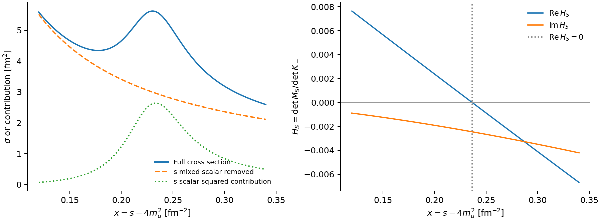

# 采样缺口、有限能量共振与原策略成本

本补充对应五个问题：旧算法是否更好、Mott 阈值是否必然造成输运跳变、是否能取消平滑、诊断图右侧结构的来源，以及原策略与新取点方案的成本。

新增数值证据为 `tail_feature_v1` 和 `baseline_cost_v2`，均位于 [原研究结果目录](../../../../data/outputs/results/relaxtime/transport/threshold_cache_upgrade_20261021/)。[followup_analysis_v1/summary.json](../../../../data/outputs/results/relaxtime/transport/threshold_cache_upgrade_20261021/followup_analysis_v1/summary.json) 保存核验与统计；本轮没有替换生产默认，也没有启动 Actions。

## 1. 原框架可以保留，原默认网格仍须改进

先前比较中达标的是“固定加密后的旧插值框架”，不是原来的稀疏配置。四格消融证明：保留 A/√x 扣除可以得到正确结果，去掉它也不能弥补网格缺口。独立 B₀ 端点问题则确实需要改善。

在 ξ=0.37 的 uū→uū 原缓存中，关键尺度

\[
x_\delta=5.08546\times10^{-5}\ \mathrm{fm}^{-2}
\]

位于两个相邻原节点

\[
x_L=1.76022\times10^{-6},\qquad x_R=0.0200\ \mathrm{fm}^{-2}
\]

之间。这个大区间内没有其他原节点。因此原表即使有 522 个节点，仍可能跨过决定阈值曲率的区域。高能区多加点、增加外层 p/角度积分点、增加截面 t 积分点，都不能自动修复这段 σ(s) 插值。

这直接支持本例的采样解释。对于“过去每一次加密”为何没有改善，仍需按当时具体加密的层级和 s 节点位置判断，不能把所有加密试验视为同一种操作。新的自适应方法提供误差检查和针对性加点；固定加密在这个代表点成本稍低，并不能说明旧算法在所有背景下更好。

## 2. 阈值共振可以尖化散射核，而不强制热平均跳变

此处被尖化的是 σ(s) 及加权散射核随入射不变量 s 的结构，不是说夸克分布函数本身出现不连续。对本次赝标量开放道主导的近阈值项，局部形式为

\[
H(x)\simeq\delta+b x-i c\sqrt{x},\qquad
\sigma(x)\simeq\frac{C(x)}{(\delta+b x)^2+c^2x}.
\]

当失谐 δ 接近零，结构尺度 `xδ=δ²/c²` 缩小，需要更细的 s 分辨率；在 δ=0、C(0)≠0 时，σ 可趋于 1/x。但热平均的近阈值运动学权重含 x，积分对象 xσ 可以保持有限。

以 b=0、C 和 c 固定的简化例子为例：

\[
J(\delta)=\int_0^X\frac{Cx}{\delta^2+c^2x}\,dx
=\frac{C}{c^2}\left[X-x_\delta\log\left(1+\frac{X}{x_\delta}\right)\right].
\]

由于 `xδ log(1+X/xδ)→0`，

\[
\lim_{\delta\to0}J(\delta)=\frac{CX}{c^2}=J(0).
\]

即使保留 b，若 C 有界、c 在相关背景邻域非零且有下界，也有 `|xσ|≤sup|C|/c²`；这给出了阈值积分保持连续的条件。背景与密度连续、总碰撞率有限且非零时，其倒数 τ 也不因这个可积阈值结构而自动发生有限跃变。

这些是有条件的结论。Mott 束缚态解离不必对应热力学一阶相变；它可以改变谱权重、宽度、斜率和变化速度。不能由此断言所有通道或所有临界极限都光滑，也不能把完整输运的变化只归因于这一个局部项。标量道的阈值幂次也不同：`Im ΠS∝x Im B₀∝x^(3/2)`，不能直接套用赝标量的全部幂次。

## 3. 取消平滑是合理目标，目前不能宣布所有异常已归因

ξ≈0.37 的主要凹陷已通过原网格/加密网格、扣除开/关、直接积分和环函数替换分开定位。对于其他非一阶跳点，数值误差是值得优先检验的工作假设，但目前没有逐窗口证据支持“全部都是同一种假跳变”。除 σ 网格外，还可能涉及环函数端点、外层求积、背景解或介子求根的分支选择。

后续若原始重算在独立方法及加密检查中稳定，离散异常也消失，就可以直接使用这些原始结果，无需再做消除异常的平滑。验收应依据收敛和分支一致性；保留真实峰谷、快速变化和可能的尖点，不能把曲线单调或处处圆滑作为正确性的要求。

## 4. 图右侧是有限宽度的混合标量 s 道共振

原诊断图使用对数横轴，窗口只到 `x=0.6 fm⁻²`；所询问的小峰实际约在 `x=0.23 fm⁻²`，不是 x=1。

本轮对 `x=0.12:0.001:0.34` 做了 221 点直接计算和振幅贡献分解。完整截面在 x≈0.230 有局部极大；s 道标量平方项在 x≈0.233 达到极大。将 **s 道混合标量传播子及相应干涉** 从诊断振幅中移除，小峰消失，余下曲线在这个窗口单调下降。t 道、赝标量 s 道保持原值。

混合标量扇区（σ/σ′）的归一化行列式

\[
H_S=\frac{\det M_S}{\det K_-}
\]

在 `x=0.23653085 fm⁻²` 处实部过零，此处 `Im HS≈−0.0024513` 非零。对应实轴能量约 435.75 MeV。非零虚部提供有限宽度，因而是一个共振峰，未发现函数断裂。截面峰、传播子峰与实部分母零点不必完全重合，因为分子、相空间、背景及干涉也随 s 变化。

这里的 435.75 MeV 是实轴共振诊断位置，不是新求得的复极点质量，也不是这个固定背景下又出现了一个 Mott 阈值。

| 核验 | 窗口内最大相对变化/误差 |
| --- | ---: |
| 截面 t24→t48 | 9.32e−11 |
| 原 B₀→paired-PV64 | 4.49e−8 |
| paired-PV64→128 | 4.00e−14 |
| 振幅贡献重建完整截面 | 4.44e−16 |

因此这处有限宽度结构在当前模型中是稳定的共振结果，应与 ξ 扫描的数值凹陷区分。

源表：[tail_feature.csv](../../../../data/outputs/results/relaxtime/transport/threshold_cache_upgrade_20261021/tail_feature_v1/tail_feature.csv)、[denominator_roots.csv](../../../../data/outputs/results/relaxtime/transport/threshold_cache_upgrade_20261021/tail_feature_v1/denominator_roots.csv)。移除贡献仅用于机制诊断，不是建议改变物理模型。

## 5. 原策略耗时、重跑预算与优化位置

原来的 20 秒量级指“建缓存 + 一次完整 p128/angle20/phi36 热平均”，不全是自适应取点成本。本轮补测了原生产接口，并在同一批次交错比较两个精度达标的候选。每种策略预热后测量三次，固定背景，不计 Julia 启动/JIT、gap 求解、其他过程、输运积分和绘图。

代表点仍为 μB=0、αT=1、ξ=0.37、uū→uū。以下为墙钟中位数：

| 策略及消费接口 | 建缓存 [s] | 热平均 [s] | 每次总耗时中位数 [s] | 总耗时范围 [s] |
| --- | ---: | ---: | ---: | ---: |
| 原稀疏缓存，原生产接口 | 2.02 | 11.44 | 13.56 | 9.92–15.19 |
| 同一原缓存，统一诊断消费者 | 2.02 | 8.38 | 10.40 | 9.89–13.15 |
| 固定 dense192，统一消费者 | 3.81 | 12.49 | 16.30 | 12.22–18.54 |
| 自适应 xσ，统一消费者 | 4.12 | 13.66 | 18.49 | 10.83–18.61 |

总耗时先逐次相加再取中位数，可能不等于两个分项中位数之和。原生产接口与统一消费者给出一致的原散射率；两者都保留原缓存约 +11.68% 的热平均偏差，以及约 +140.69% 的局部 J 偏差。固定加密和自适应 xσ 仍同时满足局部 J/热平均 `10⁻⁴` 相对误差目标。因此低成本的原结果不是同精度替代方案。

本批次自适应方案相对原生产调用的总耗时中位数增加约 4.93 秒/这个过程。三次样本仍有波动，不能将这个差值或比值承诺为所有参数的成本。此前 24 秒与本批次 18 秒来自不同计时批次，期间缓存算法没有改变，不能把跨批次差异当成新的加速成果。完整 CPU 时间及两种消费接口的记录均保留在 [cost_summary.csv](../../../../data/outputs/results/relaxtime/transport/threshold_cache_upgrade_20261021/followup_analysis_v1/cost_summary.csv)。

**这是单个散射过程的成本，不是整个 ξ 背景点。** 当前 `REQUIRED_PROCESSES` 包含 17 个过程。若仅作数量级情景，假设每道均花 18.5 秒，则一个背景点约为 `17×18.5≈315 秒`，100 个背景点约 8.7 小时串行散射计算。该情景既不是上界也不是实测整套耗时：不同质量/过程的有效积分区域、共享极化缓存、待替换过程数和 Actions 并行度都会改变预算。

实际规划应累加各类代表背景/过程的成本，再计入背景求解、启动和其他输运步骤，并除以有效并行度。若最终只需修补少数窗口的两个过程，成本会远小于全部 17 道重算。

已有源码和 profile 支持的优先优化方向：

1. **热平均中预计算和复用运动学。** 当前循环规模上限为 `128²×20²×36≈2.36×10⁸` 个组合，重复计算分布函数、三角函数和能量。可预计算 `E(p)`、`f(p,cosθ)`、`sinθ`、`cosφ` 及权重，并对相同入射背景的多个过程共用运动学计算。
2. **等质量相对速度专用式。** 本例原公式可约为 `v_rel=2√(1−4m²/s)`，有望减少内层平方根和除法；需用同一数值精度目标验证浮点差异。
3. **按实际误差选择缓存工作量。** 保留原网格中足够准确的区间，仅对误差大的阈值和共振区加点；继续复用检查点和固定背景的环函数计划。相邻 ξ 可复用网格结构作为种子，但不同背景的 σ 数值不能直接混用。

上述尚未实现的优化不计入本轮提速承诺。当前证据表明，热平均约占主要运行时间，性能工作应同时覆盖它，而不只压缩插值节点数。

## 实现与留存

- [run_threshold_tail_diagnostic.jl](../../../../scripts/analysis/relaxtime/run_threshold_tail_diagnostic.jl)：221 点扫描、振幅重建、移除贡献实验与实轴零点。
- [benchmark_threshold_baseline.jl](../../../../benchmark/relaxtime/benchmark_threshold_baseline.jl)：原生产/统一消费者同点计时和精度分类。
- [analyze_threshold_followup.py](../../../../scripts/analysis/relaxtime/analyze_threshold_followup.py)：核验输入/源码快照，汇总成本并生成图。
- [audit.json](../../../../data/outputs/results/relaxtime/transport/threshold_cache_upgrade_20261021/followup_analysis_v1/audit.json)：两批已完成运行的源码与输入核验。

`baseline_cost_v1` 在预热阶段因基准脚本漏传原扣除/缓存策略而被 fingerprint 检查拒绝，没有可用计时。失败快照保留；补齐显式参数后的 `baseline_cost_v2` 已通过原保留散射率和消费者一致性检查，未放宽容差。
